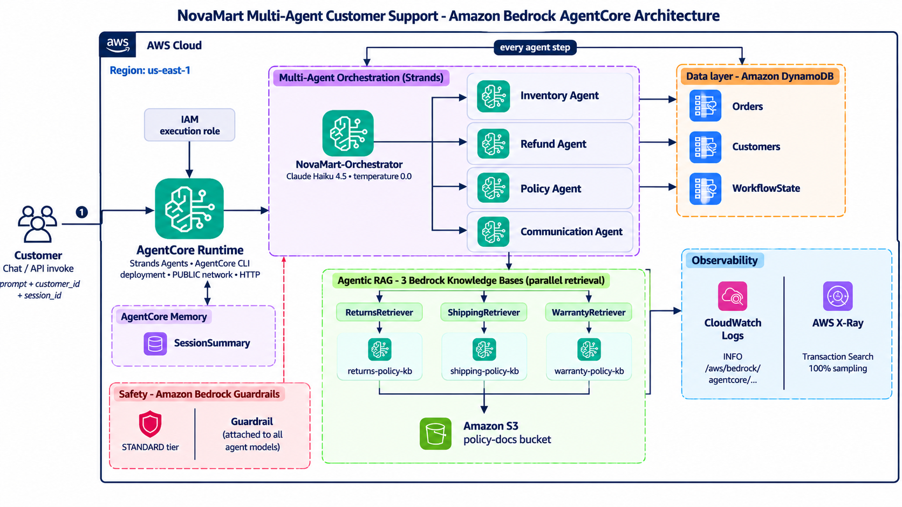
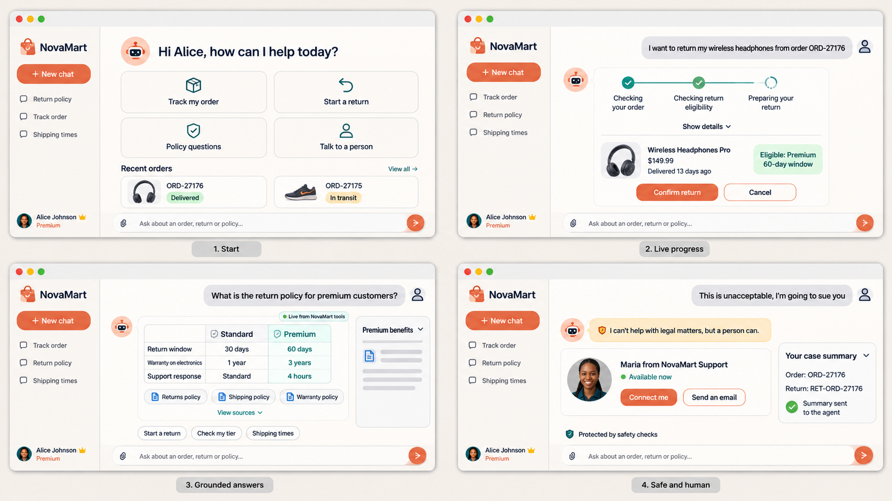
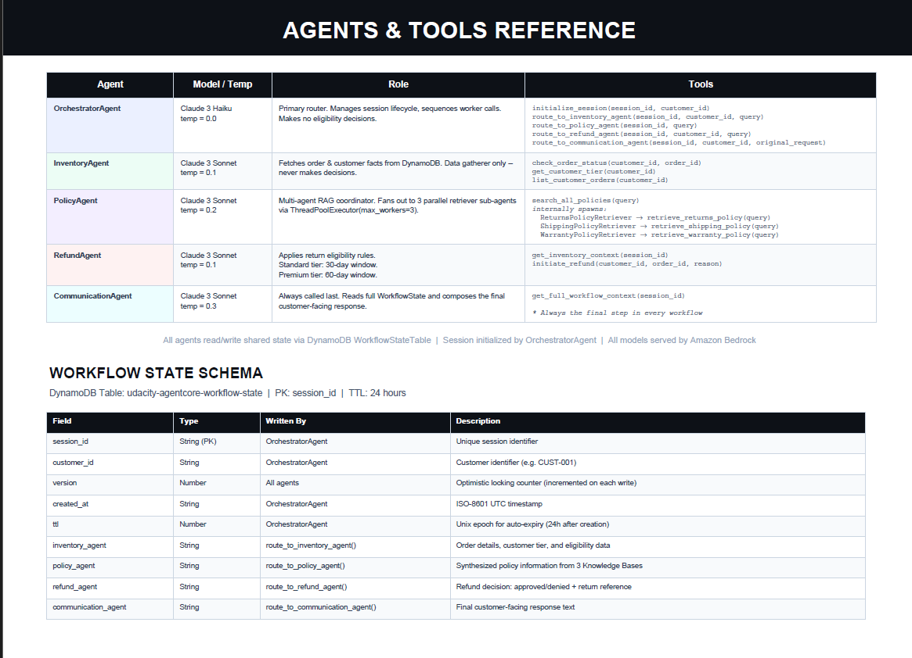
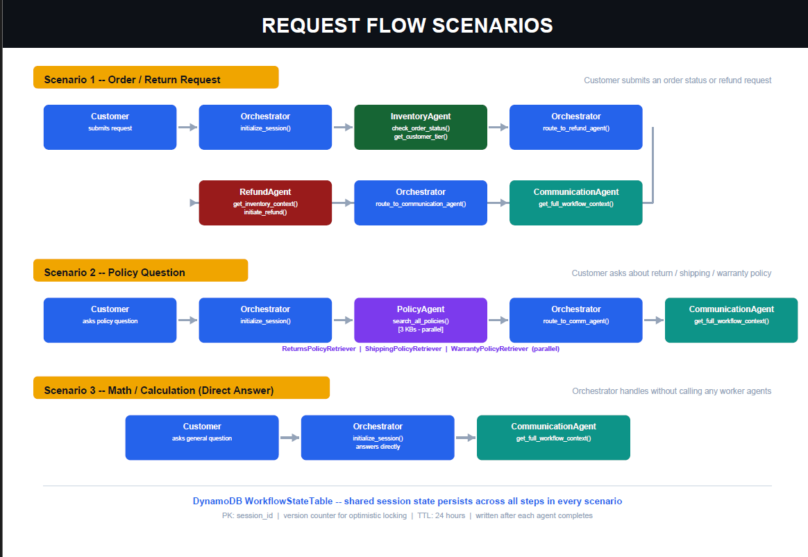

# NovaMart Multi-Agent Customer Support

A multi-agent e-commerce support system built with **Strands Agents** and **Amazon Bedrock AgentCore**. An orchestrator routes each customer request to specialist agents, retrieves policy answers from three knowledge bases in parallel, keeps shared workflow state in DynamoDB, enforces safety guardrails, and traces every request end to end.

Built as the capstone of the Future AWS Agent Engineer Nanodegree (AWS x Udacity).



**Next step: UI concept.** A chat interface for non-technical users, with interactive cards instead of plain text: live agent progress, an order card with a confirm step before a return, grounded policy answers with sources, and a human handoff.



*Design concept only; not implemented in this repo.*

## How it works

A customer message goes to the **orchestrator**, which creates a workflow session and calls the specialist agents it needs:

| Agent | Model | Job |
|---|---|---|
| Orchestrator | Claude Haiku 4.5 | Routes the request and manages workflow state |
| Inventory | Claude Sonnet 4.5 | Reads order status and customer tier from DynamoDB |
| Refund | Claude Sonnet 4.5 | Decides return eligibility and initiates the return |
| Policy | Claude Sonnet 4.5 | Fans out to 3 retrievers in parallel and synthesizes the answer |
| Communication | Claude Sonnet 4.5 | Writes the final reply and handles price/discount arithmetic |



*Agents, tools and the workflow state schema.*

### Request flows

A return request goes Inventory -> Refund -> Communication, a policy question goes Policy -> Communication, and a math question goes straight to Communication.



## Features

- **Multi-agent orchestration** with an orchestrator that picks the route per request
- **Parallel agentic RAG:** three Bedrock Knowledge Bases (returns, shipping, warranty) on S3 Vectors, queried at the same time with `ThreadPoolExecutor`
- **Shared state:** DynamoDB `WorkflowState` table with optimistic locking (version-checked writes)
- **Guardrails:** one Bedrock Guardrail (STANDARD tier) attached to all five agent models: topic denial (competitors, price negotiation, legal threats), content filters, PII blocking/anonymizing, profanity filter
- **Memory:** AgentCore Memory with a session-summary strategy
- **Observability:** CloudWatch logs and X-Ray traces, giving a service map of orchestrator -> agents -> knowledge bases
- **Deployment:** AgentCore Runtime deployed with the AgentCore CLI (PUBLIC network, HTTP protocol)

## Tech stack

Python 3.12, Strands Agents SDK, Amazon Bedrock (Claude Haiku 4.5, Sonnet 4.5, Titan Embeddings v2), Bedrock Knowledge Bases, Amazon S3 and S3 Vectors, Amazon DynamoDB, Bedrock AgentCore (Runtime, Memory), Bedrock Guardrails, CloudWatch, X-Ray, CloudFormation, AWS CDK (via the AgentCore CLI).

## Repository layout

```
.
├── src/
│   ├── agent_orchestrator.py    # agents, routing tools, guardrail, deploy, memory, observability
│   ├── agent_utils.py           # DynamoDB helpers, workflow state
│   ├── bedrock_kb_retrieval.py  # Knowledge Base retrieval tool
│   ├── agent_observability.py   # X-Ray / CloudWatch tracing helpers
│   ├── agentcore_cli.py         # wrapper around the AgentCore CLI
│   └── demo.py
├── infrastructure/
│   ├── starter_stack.yaml       # CloudFormation: tables, buckets, vector indexes, IAM role
│   ├── seed_data.py             # sample orders, customers, policy documents
│   └── cleanup.py               # removes the deployed resources
├── agentcore/                   # AgentCore CLI project (runtime config)
├── tests/test_agent.py          # 120-point verification suite
├── config.py
├── requirements.txt
└── docs/architecture.png
```

## Getting started

### Prerequisites

- Python 3.12 (matches the deployed runtime)
- An AWS account with Bedrock model access (Claude Haiku 4.5, Sonnet 4.5, Titan Embeddings v2) in `us-east-1`
- IAM permissions for Bedrock, Bedrock AgentCore, DynamoDB, S3, S3 Vectors, CloudFormation, CloudWatch and X-Ray. The AgentCore CLI deploys through AWS CDK, so `cloudformation:*`, `iam:PassRole` and the CDK bootstrap roles are needed too
- Three Bedrock Knowledge Bases, created manually in the AWS Console (step 3 below)
- The AgentCore CLI (`@aws/agentcore` on npm), which packages and deploys the runtime. It needs Node.js 20+ and `uv`:
  ```bash
  npm install -g @aws/agentcore@0.30.0
  agentcore --version
  ```
  If you have the older Python `bedrock-agentcore-starter-toolkit` installed, remove it first (`pip uninstall bedrock-agentcore-starter-toolkit`), because both install an `agentcore` command.
- The runtime runs on arm64 and Python 3.12. `agentcore deploy` downloads matching wheels with `uv`, so it needs internet access

### Install

```bash
git clone https://github.com/<your-username>/novamart-multi-agent-support.git
cd novamart-multi-agent-support
python -m venv .venv && source .venv/bin/activate
pip install -r requirements.txt
cp .env.example .env
```

1. **Deploy the base infrastructure** (DynamoDB tables, S3 buckets, IAM role):
   ```bash
   aws cloudformation deploy --template-file infrastructure/starter_stack.yaml \
     --stack-name udacity-agentcore --capabilities CAPABILITY_NAMED_IAM
   ```
2. **Seed the data:** `python infrastructure/seed_data.py`
3. **Create three Bedrock Knowledge Bases** (returns, shipping, warranty) in the console: vector store type S3 Vectors with your own vector store (not the managed option), Titan Embeddings v2, and the S3 prefixes `policies/returns/`, `policies/shipping/`, `policies/warranty/`. Put the three IDs in `.env` as `RETURNS_KB_ID`, `SHIPPING_KB_ID` and `WARRANTY_KB_ID`.
4. **Deploy the agents:** creates the guardrail, deploys to AgentCore Runtime, configures memory and observability.
   ```bash
   python src/agent_orchestrator.py deploy
   ```
   Add the printed `AGENTCORE_RUNTIME_ARN`, `GUARDRAIL_ID` and `GUARDRAIL_VERSION` to `.env`.

## Usage

```bash
python src/agent_orchestrator.py test                     # run the 3 test scenarios locally
python src/agent_orchestrator.py chat                     # interactive terminal chat
python src/agent_orchestrator.py invoke "What is the return policy for premium customers?"
python tests/test_agent.py all                            # verification suite (120 points)
```

Traces appear in CloudWatch under X-Ray traces / Trace Map after a run.

## Cleanup

```bash
python infrastructure/cleanup.py --yes
```

Removes the deployed AWS resources so they stop costing money.

## What I learned

- A small, fast model for routing and stronger models for specialist work keeps the system fast and accurate
- Parallel retrieval cuts latency, but the results still need a single synthesis step
- Optimistic locking keeps shared agent state consistent
- Guardrail topic definitions need careful wording, or they block legitimate requests such as plain arithmetic
- Real deployments (IAM roles, resource conflicts, tracing) teach more than the happy path
